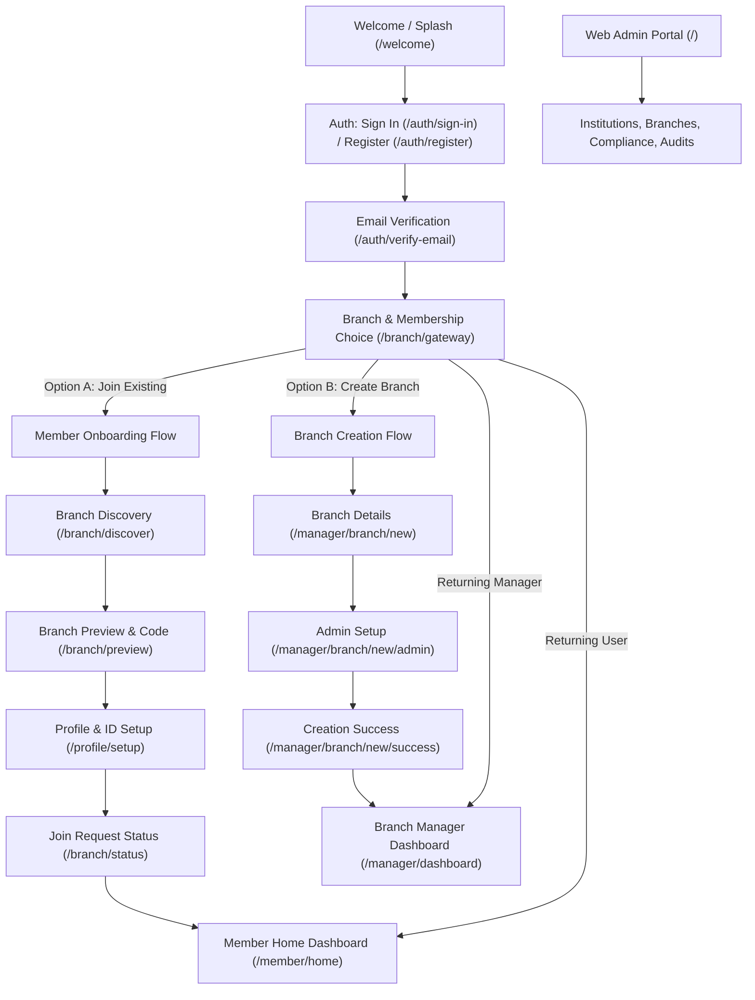

# Kivora Application Route & Screen Hierarchy

This document defines the complete route hierarchy, screen relationships, access controls, and navigation pathways across the Kivora platform, covering the Mobile Flutter App (Members, Managers, Onboarding) and the Next.js Web Admin Portal.

---

## 1. Architectural Overview & Experience Domains

Kivora operates as one unified platform organized into four cohesive experience hierarchies:



---

## 2. Onboarding & Post-Sign-In Gateway

| Screen ID | Route | Screen Name | Parent / Entry | Access | Next Navigation / Action |
|:---|:---|:---|:---|:---|:---|
| **M01 / BO01** | `/welcome` | Welcome & Splash Screen | App Launch | Public | `Get Started` → `/auth/register`<br>`Sign In` → `/auth/sign-in` |
| **M02 / BO02** | `/auth/sign-in` | Sign In Screen | `/welcome` | Public | Auth success → Role resolution (`/member/home`, `/manager/dashboard`, `/branch/status`, or `/branch/gateway`) |
| **M03** | `/auth/register` | Register Screen | `/welcome` | Public | Form submit → `/auth/verify-email` |
| **M04 / BO04** | `/auth/verify-email` | Email Verification | `/auth/register` | Public | 6-digit OTP / verify → `/branch/gateway` |
| **BM03 / BO03** | `/branch/gateway`<br>`/manager/branch-gateway` | Branch & Membership Choice | `/auth/verify-email`<br>Post-auth unassigned | Authenticated | **Option A**: `/branch/discover`<br>**Option B**: `/manager/branch/new`<br>Returning Member: `/member/home`<br>Returning Manager: `/manager/dashboard` |

---

## 3. Member Journey Hierarchy

**Root Entry Point:** `/member/home` (M09)

```
/member/home (M09: Member Home Dashboard)
├── Attendance Workflow
│   ├── /member/attendance/check-in (M12: Multi-Factor Attendance Check-In)
│   ├── /member/attendance/biometric (M13: Biometric Scan Verification)
│   ├── /member/attendance/gps (M14: Geofence & GPS Verification)
│   ├── /member/attendance/result (M15: Verification Result Confirmation)
│   ├── /member/attendance/history (M16: Attendance History & Calendar)
│   ├── /member/attendance/records/:id (M17: Detailed Attendance Log)
│   └── /member/attendance/totals (M18: Attendance Statistics & Rates)
├── Schedule & Classes
│   ├── /member/schedule (M20: Class & Work Schedule Calendar)
│   ├── /member/classes/:id (M23: Class Details & Roster)
│   └── /member/department (M24: Department Teaching Assignments)
├── Identity & Branch
│   ├── /member/digital-id (M22: Digital ID Card with QR & Barcode)
│   └── /member/branch (M25: Branch Information & Contacts)
├── Member Requests
│   ├── /member/requests (M28: Requests History & Status)
│   ├── /member/requests/leave/new (M26: Submit Leave Request)
│   ├── /member/requests/correction/new (M27: Submit Attendance Correction)
│   ├── /member/transfer/new (M31: Request Branch Transfer)
│   └── /member/transfer/history (M32: Branch Transfer History)
├── Profile & Settings
│   ├── /member/profile (M29: Member Profile Overview)
│   ├── /member/profile/edit (M30: Edit Profile Details)
│   ├── /member/settings (M33: App Settings & Preferences)
│   ├── /member/settings/security (M34: Security & Password)
│   ├── /member/settings/permissions (M35: Device Permissions)
│   └── /member/settings/help (M36: Help, FAQ & Privacy)
└── Notifications & Search
    ├── /member/notifications (M10: Notifications Center)
    └── /member/search (M11: Quick Search & Actions)
```

---

## 4. Branch Manager Journey Hierarchy

**Root Entry Point:** `/manager/dashboard` (BM07)

```
/manager/dashboard (BM07: Branch Manager Dashboard)
├── Member Management
│   ├── /manager/members (BM08: Members Directory & List)
│   ├── /manager/members/overview (BM23: Members Analytics Overview)
│   ├── /manager/members/:id (BM09: Member Profile & History Detail)
│   ├── /manager/members/:id/documents (BM10: Document & NIN Review)
│   ├── /manager/requests/membership (BM11: Membership Application Approvals)
│   └── /manager/invites/generate (BM12: Generate Branch Invite Code)
├── Attendance Supervision
│   ├── /manager/attendance/logs (BM13: Live Attendance Logs)
│   ├── /manager/attendance/overview (BM24: Attendance Overview & Stats)
│   ├── /manager/requests/early-leave (BM14: Early Departure Requests)
│   ├── /manager/requests/leave (BM25: Leave Request Management)
│   └── /manager/logs/verification (BM20: Verification Audit Logs)
├── Branch Operations & Schedules
│   ├── /manager/schedules (BM16: Schedule Management & Rotas)
│   ├── /manager/announcements/new (BM15: Broadcast Announcement)
│   ├── /manager/messages (BM22: Branch Chat & Messaging)
│   ├── /manager/reports (BM17: Branch Attendance & Metric Reports)
│   ├── /manager/requests/transfers (BM27: Branch Transfer Approvals)
│   └── /manager/logs/audit (BM21: Security Audit History)
└── Branch Governance & Settings
    ├── /manager/settings/branch (BM18: Branch Profile & Policies)
    ├── /manager/settings/roles (BM19: Staff Roles & Access Permissions)
    ├── /manager/roles/edit (BM26: Create & Edit Custom Roles)
    ├── /manager/settings (BM-EXTRA: General App Settings)
    ├── /manager/support (BM-EXTRA: Help & Support)
    ├── /manager/privacy (BM-EXTRA: Privacy & Compliance Policy)
    ├── /manager/about (BM-EXTRA: About Kivora Enterprise)
    └── /manager/permissions (BM-EXTRA: Device Hardware Permissions)
```

---

## 5. Web Admin Hierarchy

**Root Entry Point:** `/` (WA01: Web Admin Overview)

```
/ (WA01: Dashboard Overview)
├── Institutions & Branches
│   ├── /branches (WA02: Branch Directory)
│   ├── /branches/new (WA03: Register Branch)
│   ├── /branches/:id (WA04: Branch Details & Hierarchy)
│   ├── /branches/:id/settings (WA05: Branch Geofence & Rules)
│   └── /transfers (WA06: Cross-Branch Transfers)
├── Identity & Access Management
│   ├── /users (WA07: User Accounts Directory)
│   ├── /users/:id (WA08: User Profile & Audit)
│   ├── /roles (WA09: Global Roles & Permissions Matrix)
│   └── /invites (WA10: Enterprise Invite Management)
├── Attendance & Verification
│   ├── /attendance (WA11: Global Attendance Master Logs)
│   ├── /attendance/anomalies (WA12: Spoofing & Geofence Flags)
│   └── /verification-methods (WA13: Multi-Factor Configuration)
├── Analytics & Compliance
│   ├── /reports (WA14: Institutional Attendance Reports)
│   ├── /compliance (WA15: Regulatory & Accreditation Audits)
│   ├── /audit-logs (WA16: System-wide Tamper-proof Audit Trails)
│   └── /security (WA17: Security Posture & Incident Response)
└── System Configuration
    ├── /settings (WA18: Enterprise Tenant Configuration)
    ├── /integrations (WA19: SIS, HRIS & Webhooks)
    ├── /backups (WA20: Disaster Recovery & Replication)
    └── /billing (WA21: Subscriptions & License Usage)
```

---

## 6. Access Control & Deep Linking Guard Matrix

| Experience Area | Minimum Role Required | Unauthenticated Action | Unauthorized Action |
|:---|:---|:---|:---|
| **Public / Auth** | None (Guest) | Allow | Allow |
| **Branch Gateway** | Authenticated User | Redirect `/auth/sign-in` | Redirect `/auth/sign-in` |
| **Member Area** | Member / Student / Staff | Redirect `/auth/sign-in` | Redirect `/branch/gateway` |
| **Manager Area** | Branch Manager / Admin | Redirect `/manager/sign-in` | Redirect `/member/home` |
| **Web Admin Area** | Institution Admin / Superadmin | Redirect `/login` | HTTP 403 Forbidden |

---

## 7. Back Navigation & Session Lifecycles

1. **Back Button Behavior**:
   - In all detail views, modals, and wizards, AppBar `leading` invokes `context.pop()` if history is available; otherwise, it deterministically routes to the parent route (`/member/home`, `/manager/dashboard`, `/branch/gateway`, etc.).
2. **Session Expiry**:
   - On expired auth token or Supabase session loss, all routes safely redirect to the appropriate sign-in gateway (`/auth/sign-in` or `/manager/sign-in`).
3. **Sign Out**:
   - Member sign-out (`/member/settings`) and Manager sign-out (`/manager/settings`) clear active session cache and return the user cleanly to `/welcome`.
